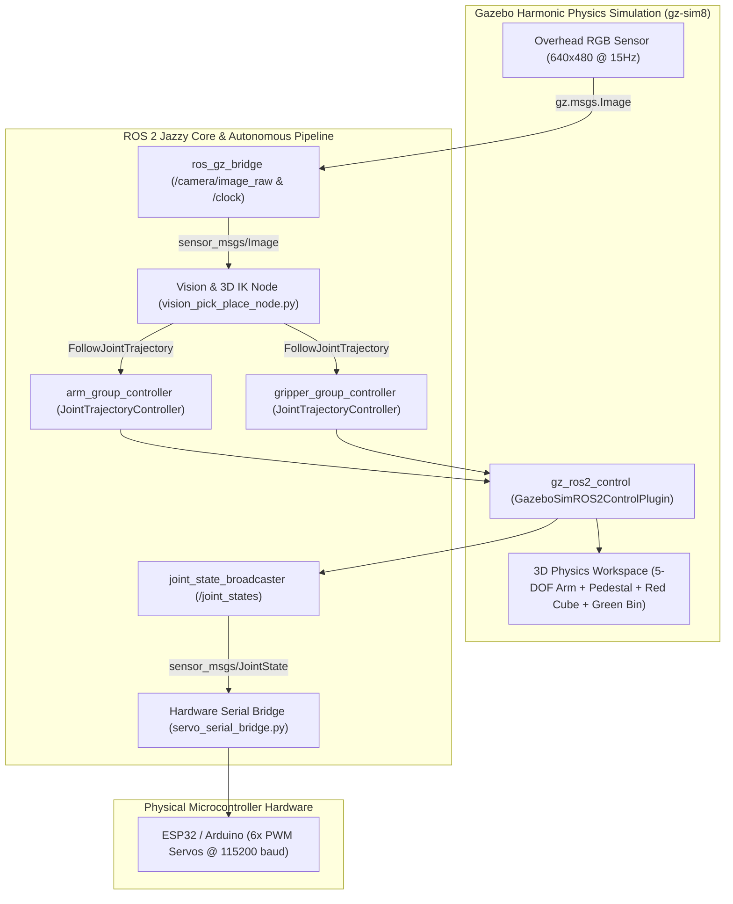
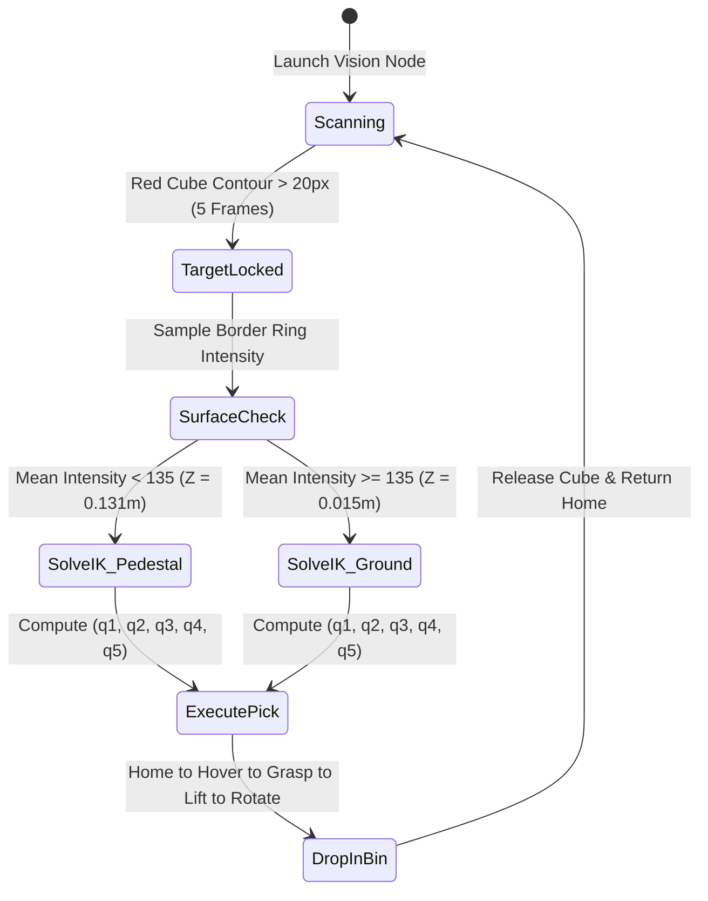

# Autonomous 5-DOF Robotic Arm: Vision-Guided Pick & Place


-FF6F00?logo=gazebo&logoColor=white)


An end-to-end autonomous robotic manipulation stack built from custom CAD assemblies in **ROS 2 Jazzy** and **Gazebo Harmonic**. This project integrates **MoveIt 2** motion planning, rigid-body physics simulation, **OpenCV** overhead spatial localization, a custom analytical **3D 5-DOF Inverse Kinematics (IK)** solver, and a real-time **ESP32/Arduino hardware serial bridge**.

---

## Table of Contents
1. [Project Overview](#project-overview)
2. [System Architecture](#system-architecture)
3. [Key Engineering Features](#key-engineering-features)
4. [Mathematical Formulation (5-DOF Analytical IK)](#mathematical-formulation-5-dof-analytical-ik)
5. [Kinematic Chain & Joint Specifications](#kinematic-chain--joint-specifications)
6. [Repository Structure](#repository-structure)
7. [Installation & Setup](#installation--setup)
8. [Usage & Launch Modes](#usage--launch-modes)
9. [Hardware Integration (ESP32 / Arduino)](#hardware-integration-esp32--arduino)
10. [Author](#author)

---

## Project Overview

Traditional 6-DOF industrial manipulators have full orientation freedom, whereas **5-DOF robotic arms** are underactuated (lacking a 6th wrist yaw/roll axis) and require specialized position-only inverse kinematics coupled with wrist pitch compensation.

This project solves the complete autonomous pipeline for a custom 5-DOF robotic arm:
* **Perception:** An overhead RGB camera mounted in Gazebo streams live frames over `ros_gz_bridge` to an OpenCV vision node that detects targets, estimates their 3D coordinates $(X, Y, Z)$, and classifies whether the target rests on a raised pedestal or directly on the ground.
* **Planning & Control:** An analytical 5-DOF IK solver computes collision-free joint trajectories for **Hover**, **Grasp**, **Lift**, and **Place** states, driving Gazebo's `gz_ros2_control` `JointTrajectoryController` servers.
* **Sim-to-Real Telemetry:** A serial bridge node subscribes to `/joint_states` and streams calibrated PWM degree packets (`<S1,S2,S3,S4,S5,S6>`) over USB at 115200 baud to mirror simulated motions on physical servos.

---

## System Architecture



### Autonomous State Machine Workflow



---

## Key Engineering Features

* **CAD-to-URDF Mesh Pipeline (`arm_description`):** Leveled, centered, and scaled binary STL meshes (`0.001` mm-to-m scale) with custom inertial tensors, high-friction finger contact surfaces ($\mu_1 = \mu_2 = 50.0$, $k_p = 10^5$), and tuned `gz_ros2_control` proportional gains ($K_p = 20.0$) for slip-free grasping.
* **MoveIt 2 Integration (`arm_moveit_config`):** Configured with `KDLKinematicsPlugin` (`position_only_ik: true`), OMPL `RRTConnect` planning, and `AddTimeOptimalParameterization` velocity/acceleration scaling.
* **Dual-Elevation Computer Vision (`arm_pick_place`):** Uses HSV color segmentation to localize target centroids and samples a 12-pixel luminance ring around the bounding box to distinguish raised pedestal targets ($Z = 0.1309\text{ m}$) from floor targets ($Z = 0.0150\text{ m}$).
* **Continuous Re-Pick Capability:** Automatically monitors the workspace after placing the object in the green collection bin; dragging the cube to any new $(X, Y, Z)$ location in Gazebo triggers a new IK calculation and pick cycle immediately.

---

## Mathematical Formulation (5-DOF Analytical IK)

### 1. Overhead Camera 2D-to-3D Projection
Given the downward-facing camera at $(X_c = 0.18\text{ m}, Y_c = 0.05\text{ m}, Z_c = 0.62\text{ m})$ with horizontal field of view $\text{HFOV} = 1.20\text{ rad}$ and resolution $640 \times 480$:

$$f_{px} = \frac{640 / 2}{\tan(1.20 / 2)} \approx 467.74\text{ px}, \qquad \Delta Z = Z_c - Z_{target}$$

$$X_{world} = X_c - \frac{(v - 240)}{f_{px}} \cdot \Delta Z, \qquad Y_{world} = Y_c - \frac{(u - 320)}{f_{px}} \cdot \Delta Z$$

### 2. Planar 2-Link Inverse Kinematics & Wrist Compensation
With link lengths $L_1 = 0.11423\text{ m}$ (`joint_2` to `joint_3`) and $L_2 = 0.12982\text{ m}$ (`joint_3` to `joint_5`), radial distance $r = \sqrt{X_{world}^2 + Y_{world}^2}$, and lateral gripper offset compensation $\Delta\psi$:

$$\theta_1 = \text{atan2}(Y_{world}, X_{world}) - \Delta\psi$$

$$\cos(\theta_3) = \frac{d^2 - L_1^2 - L_2^2}{2 L_1 L_2}, \qquad \theta_3 = \arccos(\cos\theta_3)$$

$$\theta_2 = \text{atan2}(r_w, z_w) - \text{atan2}(L_2 \sin\theta_3, L_1 + L_2 \cos\theta_3)$$

$$\theta_5 = \Phi_{desired} - (\theta_2 + \theta_3)$$

---

## Kinematic Chain & Joint Specifications

| Joint Name | Type | Parent to Child | Axis | Limits (rad) | Max Vel (rad/s) | Max Accel (rad/s^2) | Role |
| :--- | :--- | :--- | :--- | :--- | :--- | :--- | :--- |
| `joint_1` | Revolute | `base_link` -> `waist_link` | `[0, 0, 1]` | `[-3.14, 3.14]` | `2.0` | `2.0` | Waist Yaw (q1) |
| `joint_2` | Revolute | `waist_link` -> `arm_01_link` | `[0, 1, 0]` | `[-1.57, 1.57]` | `2.0` | `2.0` | Shoulder Pitch (q2) |
| `joint_3` | Revolute | `arm_01_link` -> `arm_02_link` | `[0, 1, 0]` | `[-2.00, 2.00]` | `2.0` | `2.0` | Elbow Pitch (q3) |
| `joint_4` | Revolute | `arm_02_link` -> `arm_03_link` | `[0.03, 0, 0.99]` | `[-3.14, 3.14]` | `2.5` | `2.5` | Forearm Roll (q4) |
| `joint_5` | Revolute | `arm_03_link` -> `gripper_base_link` | `[0, 1, 0]` | `[-1.57, 1.57]` | `3.0` | `3.0` | Wrist Pitch (q5) |
| `gripper_left_joint` | Revolute | `gripper_base_link` -> `left_finger_link` | `[0.99, 0, 0.07]` | `[-0.25, 0.60]` | `1.0` | `1.0` | Left Gripper Jaw |
| `gripper_right_joint` | Revolute | `gripper_base_link` -> `right_finger_link` | `[-0.99, 0, -0.07]` | `[-0.25, 0.60]` | `1.0` | `1.0` | Right Gripper Jaw |

---

## Repository Structure

```text
arm_ws/
└── src/
    ├── arm_description/                  # Robot URDF/Xacro, cleaned STL meshes, SDF world models
    │   ├── launch/
    │   │   └── gazebo.launch.py          # Spawns robot, pedestal, cube, green bin, camera & controllers
    │   ├── meshes/                       # Binary STL meshes (base, waist, arm_01..03, gripper, gears, fingers)
    │   └── urdf/
    │       ├── arm.urdf.xacro            # Parametric URDF + gz_ros2_control interfaces & contact physics
    │       ├── overhead_camera.sdf       # Downward-facing RGB sensor model
    │       └── target_cube.sdf           # High-friction target object
    ├── arm_moveit_config/                # MoveIt 2 configuration package
    │   ├── config/
    │   │   ├── five_dof_arm.srdf         # Planning groups (arm_group, gripper_group) & collision matrix
    │   │   ├── joint_limits.yaml         # Velocity & acceleration limits for TOTG
    │   │   ├── kinematics.yaml           # KDL position_only_ik solver settings
    │   │   └── ros2_controllers.yaml     # JointTrajectoryController configurations
    │   └── launch/
    │       └── demo.launch.py            # Interactive RViz2 motion planning demo
    └── arm_pick_place/                   # Autonomous Vision, IK & Hardware Bridge package
        ├── arm_pick_place/
        │   ├── vision_pick_place_node.py # OpenCV overhead tracker + 3D 5-DOF analytical IK solver
        │   ├── pick_place_node.py        # Standalone trajectory action client node
        │   └── servo_serial_bridge.py    # ROS 2 /joint_states to USB Serial PWM packet streamer
        ├── firmware/
        │   └── esp32_arm_controller.ino  # Microcontroller firmware for 6 physical PWM servos
        └── launch/
            └── autonomous_pick_place.launch.py # Single-command master launch file
```

---

## Installation & Setup

### 1. System Requirements
* **OS:** Ubuntu 24.04 LTS (Noble Numbat) / WSL2 with GUI support
* **ROS 2 Distribution:** ROS 2 Jazzy Jalisco
* **Simulator:** Gazebo Harmonic (`gz-sim8`)

### 2. Install Dependencies
```bash
sudo apt update && sudo apt install -y \
  ros-jazzy-desktop \
  ros-jazzy-moveit \
  ros-jazzy-ros-gz \
  ros-jazzy-gz-ros2-control \
  ros-jazzy-ros2-control \
  ros-jazzy-ros2-controllers \
  python3-colcon-common-extensions \
  python3-opencv \
  python3-serial
```

### 3. Build the Workspace
```bash
git clone https://github.com/Yashs2024/autonomous-5dof-pick-place.git ~/arm_ws
cd ~/arm_ws
colcon build --symlink-install
source install/setup.bash
```

---

## Usage & Launch Modes

### Mode 1: Full Autonomous Vision Pick-and-Place (Single Command)
Launches Gazebo Harmonic, spawns all workspace entities, activates `ros2_control` controllers, starts the OpenCV 3D IK node, and runs the hardware serial bridge:
```bash
source ~/arm_ws/install/setup.bash
ros2 launch arm_pick_place autonomous_pick_place.launch.py
```

### Mode 2: Step-by-Step Manual Launch (Two Terminals)
**Terminal 1 — Launch Gazebo Harmonic Simulation:**
```bash
source ~/arm_ws/install/setup.bash
ros2 launch arm_description gazebo.launch.py
```

**Terminal 2 — Run the Vision & 3D IK Node:**
```bash
source ~/arm_ws/install/setup.bash
ros2 run arm_pick_place vision_pick_place_node
```

### Mode 3: MoveIt 2 Interactive RViz Planning Demo
```bash
source ~/arm_ws/install/setup.bash
ros2 launch arm_moveit_config demo.launch.py
```

---

## Hardware Integration (ESP32 / Arduino)

1. Flash `src/arm_pick_place/firmware/esp32_arm_controller.ino` to your Arduino or ESP32 using the Arduino IDE.
2. Connect your 6 servos to PWM pins `3, 5, 6, 9, 10, 11` with an external 5V-6V power supply (common ground with the microcontroller).
3. Plug the microcontroller into USB (`/dev/ttyUSB0` or `/dev/ttyACM0`) and run:
```bash
ros2 run arm_pick_place servo_serial_bridge --ros-args -p serial_port:=/dev/ttyUSB0
```

---

## Author

**Yash Surve**  
*Automation & Robotics Engineering*
